# 📘 SAITEK Tektronix Quick Start SW 초보자용 완벽 사용자 가이드

> **대상 독자**: 계측기 원격 제어(SCPI / TSP)나 파이썬 프로그램을 전혀 다뤄본 적이 없는 초보자  
> **제공 문서 포맷**:
> - **PowerPoint 프레젠테이션 (`.pptx`)**: `01.docs/06.development_guides/SAITEK Tektronix Quick Start SW_Beginner_User_Guide.pptx` (및 `06.Release/` 폴더 내 포함)
> - **PDF 사용자 매뉴얼 (`.pdf`)**: `01.docs/06.development_guides/SAITEK Tektronix Quick Start SW_Beginner_User_Guide.pdf` (및 `06.Release/` 폴더 내 포함)
> - **Markdown 가이드 (`.md`)**: `01.docs/06.development_guides/SAITEK Tektronix Quick Start SW_Beginner_User_Guide.md`

---

## 목차 (Table of Contents)

1. [프로그램 개요 및 4대 핵심 기능](#1-프로그램-개요-및-4대-핵심-기능)
2. [STEP 0. 새 PC에 프로그램 설치하기 (`SAITEK Tektronix Quick Start SW_Setup.exe`)](#2-step-0-새-pc에-프로그램-설치하기-saitek-tektronix-quick-start-sw_setupexe)
3. [STEP 1. 프로그램 첫 실행 — 초보자용 장비 연결 점검 마법사](#3-step-1-프로그램-첫-실행--초보자용-장비-연결-점검-마법사)
4. [STEP 2. 메인 화면 전체 구조 한눈에 보기 (6대 영역)](#4-step-2-메인-화면-전체-구조-한눈에-보기-6대-영역)
5. [STEP 3. 장비 연결하기 (`[VIRTUAL]` 가상 연습 모드 vs 실제 장비 USB/LAN 연결)](#5-step-3-장비-연결하기-virtual-가상-연습-모드-vs-실제-장비-usblan-연결)
6. [STEP 4. 좌측 패널 — 장비 모델 선택, 매뉴얼 열기, [사용자 입력 필수 파라미터] 설정](#6-step-4-좌측-패널--장비-모델-선택-매뉴얼-열기-사용자-입력-필수-파라미터-설정)
7. [STEP 5. 중앙 패널 — [측정 가능 항목] 선택 및 동작 전 최종 확인 팝업](#7-step-5-중앙-패널--측정-가능-항목-선택-및-동작-전-최종-확인-팝업)
8. [STEP 6. 실시간 측정 제어 (`▶ 시작` / `⏸ 일시정지` / `⏹ 완전 정지`) 및 그래프 분석](#8-step-6-실시간-측정-제어--시작---일시정지---완전-정지-및-그래프-분석)
9. [8개 장비 분류별 측정 실습 및 고급 화면 기능 가이드 (`01. AFGs` ~ `08. Tek VISA`)](#9-8개-장비-분류별-측정-실습-및-고급-화면-기능-가이드-01-afgs--08-tek-visa)
10. [STEP 7. 측정 데이터 Excel (`.xlsx`) 4-시트 자동 저장 및 초보자 FAQ](#10-step-7-측정-데이터-excel-xlsx-4-시트-자동-저장-및-초보자-faq)

---

## 1. 프로그램 개요 및 4대 핵심 기능

본 프로그램은 `01.docs/10. Tek_Manuals` 폴더 내 **8개 장비 제품군 폴더(총 30종 공식 프로그래머·레퍼런스 매뉴얼 PDF)**를 기반으로 개발된 통합 계측 제어 및 데이터 수집 프로그램입니다.

1. **8개 매뉴얼 폴더별 전용 탭 분리 (`01 ~ 08` 순서)**:
   - `01. AFGs` (임의/함수 파형 발생기)
   - `02. DC power Supplies` (프로그래머블 직류 전원공급기: Series 2200 / 2260B)
   - `03. DMM` (Keithley DMM6500 / DMM7510 / Model 2110 / Model 2010 정밀 디지털 멀티미터)
   - `04. Oscilloscopes` (오실로스코프 다중 채널 `CH1~CH4` 동시 파형 캡처 및 자동 계측)
   - `05. Spectrum Analyzers` (실시간 스펙트럼 분석기 RF 피크 분석)
   - `06. SMUs` (Keithley SourceMeter 정밀 I-V 스윕 및 저항 측정)
   - `07. DC Precision test` (MP5000 모듈형 TSP 정밀 테스트 시스템)
   - `08. Tek VISA` (범용 VISA 명령어 루프 테스트 및 버스 모니터)
2. **[사용자 입력 필수 파라미터]와 [측정 가능 항목]의 명확한 분리 및 시작 전 최종 확인 팝업**
3. **`▶ 측정 시작` / `⏸ 일시정지 & 재개` / `⏹ 완전 정지 (출력 즉시 OFF 안전 차단)` / 실시간 그래프 & 데이터 표 개별 새 창 분리(`Pop-Out`) / Excel (`.xlsx`) 저장**
4. **아무것도 모르는 초보자도 그대로 따라 할 수 있는 단계별 장비 연결 점검 마법사 (`StartupReadinessDialog`) 및 사이텍(주) 기술 지원 안내**

---

## 2. STEP 0. 새 PC에 프로그램 설치하기 (`SAITEK Tektronix Quick Start SW_Setup.exe`)

다른 PC에 Python이나 관련 프로그램이 전혀 설치되어 있지 않아도 **`06.Release/SAITEK Tektronix Quick Start SW_Setup.exe`** 파일 1개만 복사하여 실행하면 모든 필수 파일이 설치됩니다.

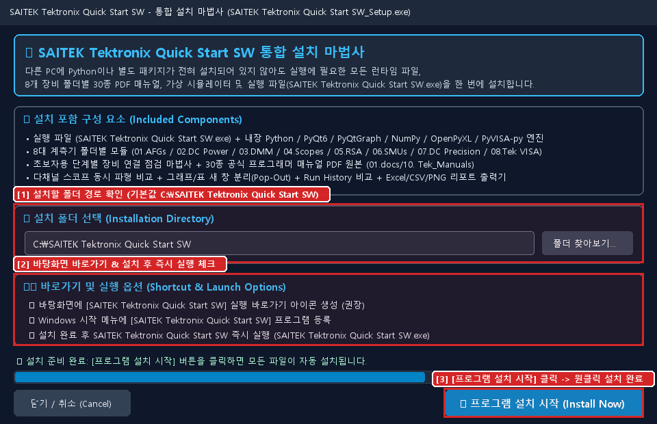

1. **`[1] 설치 폴더 경로 확인`**: 기본 설치 위치는 `C:\SAITEK Tektronix Quick Start SW` 입니다. 원하는 폴더로 변경하려면 **[폴더 찾아보기...]**를 클릭합니다.
2. **`[2] 바로가기 및 실행 옵션 체크`**: 바탕화면 바로가기 아이콘 생성 및 설치 완료 후 즉시 실행 옵션을 체크합니다.
3. **`[3] [🚀 프로그램 설치 시작]` 클릭**: 내장된 실행 파일(`SAITEK Tektronix Quick Start SW.exe`), 런타임 라이브러리, 30종 PDF 매뉴얼이 자동 설치되며 바탕화면의 **`SAITEK Tektronix Quick Start SW`** 아이콘으로 언제든 실행할 수 있습니다.

---

## 3. STEP 1. 프로그램 첫 실행 — 초보자용 장비-PC 연결 가이드 팝업창

프로그램(`SAITEK Tektronix Quick Start SW.exe`)을 처음 실행하면(또는 메인 화면 상단 바의 **`[📋 사전 준비 점검표]`** 버튼을 클릭하면) 가장 먼저 아래와 같은 **초보자용 장비-PC 연결 가이드 및 항목별 사전 준비 점검 마법사** 팝업창이 열립니다.

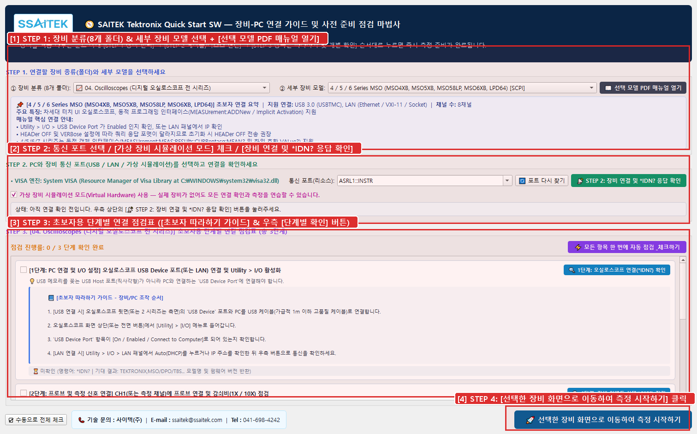

1. **`[1] STEP 1 — 연결할 장비 종류(8개 폴더)와 세부 모델 선택`**:
   - **① 장비 분류 (`01. AFGs` ~ `08. Digit Multimeter(DMM)`)**와 **② 세부 장비 모델**을 선택합니다.
   - 모델을 선택하는 즉시 아래 **파란색 요약 박스**에 해당 장비의 **지원 연결 인터페이스(USB / LAN / GPIB / RS-232), 최대 채널 수, 매뉴얼 핵심 연결 안내**가 자동으로 표시됩니다.
   - 우측 **`[📖 선택 모델 PDF 매뉴얼 열기]`** 버튼을 누르면 해당 장비의 공식 PDF 프로그래머/레퍼런스 매뉴얼 원본이 즉시 열립니다.
2. **`[2] STEP 2 — PC와 장비 통신 포트(USB / LAN / 가상 시뮬레이션) 선택 및 연결 확인`**:
   - 현재 PC에서 감지된 VISA 엔진(`System VISA` 또는 `PyVISA-py`)과 연결 가능한 통신 포트(리소스) 목록을 보여줍니다. 케이블 연결 후 **`[🔄 포트 다시 찾기]`** 버튼으로 장비를 다시 스캔할 수 있습니다.
   - 실제 장비 없이 연습할 때는 보라색 **`[☑ 가상 장비 시뮬레이션 모드(Virtual Hardware) 사용]`** 체크박스를 켜 둔 상태로 진행합니다.
   - 우측 초록색 **`[📡 STEP 2: 장비 연결 및 *IDN? 응답 확인]`** 버튼을 클릭하면 장비와 즉시 통신을 시도하여 아래 상태 표시줄에 **`✅ 연결 성공 (1.1 ms) | *IDN? 응답: TEKTRONIX,...`** 결과를 보여줍니다.
3. **`[3] STEP 3 — 초보자용 단계별 연결 점검표 따라하기 및 개별/일괄 확인`**:

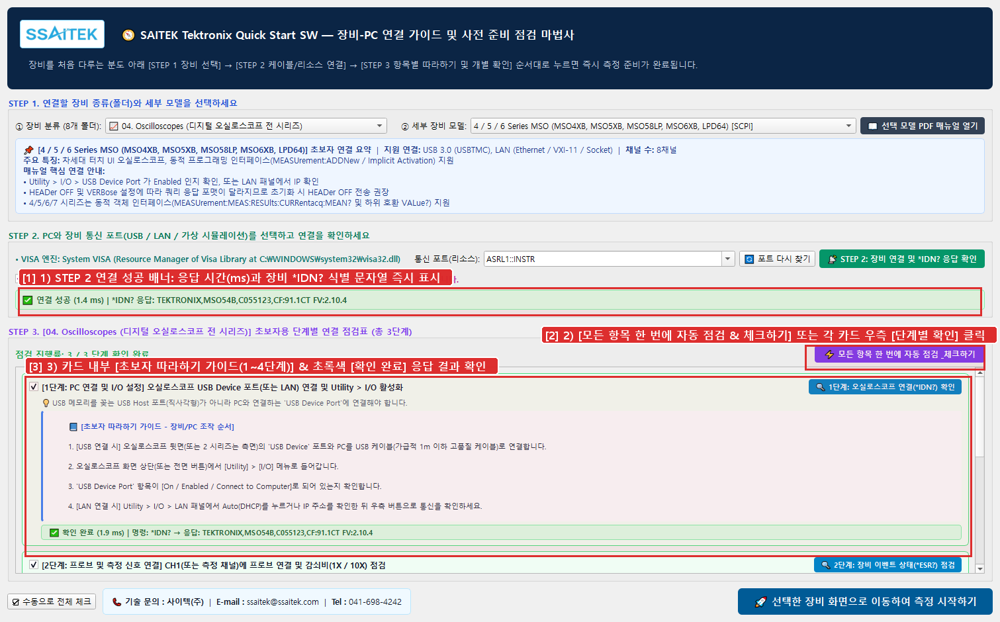

   - 각 점검 카드 안에는 파란색 **`📘 [초보자 따라하기 가이드 - 장비/PC 조작 순서]`** 박스가 펼쳐져 있어 **1단계 ~ 4단계 순서**(어느 포트에 케이블을 꽂는지, 장비 전면 패널의 어떤 메뉴 버튼을 눌러야 하는지)를 그대로 따라 할 수 있습니다.
   - 각 카드 우측의 파란색 **`[🔍 1단계/2단계 확인]`** 버튼을 개별 클릭하거나, 우측 상단 보라색 **`[⚡ 모든 항목 한 번에 자동 점검 & 체크하기]`** 버튼을 누르면 프로그램이 장비에 직접 검증 명령어(`*IDN?`, `*LANG?`, `:ROUTe:TERMinals?`, `SYSTem:ERRor?`, `*ESR?`)를 전송해 응답을 확인합니다.
   - 정상 응답이 확인되면 카드가 초록색 **`[✅ 확인 완료]`** 상태로 바뀌고 좌측 체크박스(☑)가 자동으로 체크됩니다.
4. **`[📘 초보자 연결 가이드 보기]` 상세 안내 팝업창 (메인 화면에서도 언제든 열람 가능)**:

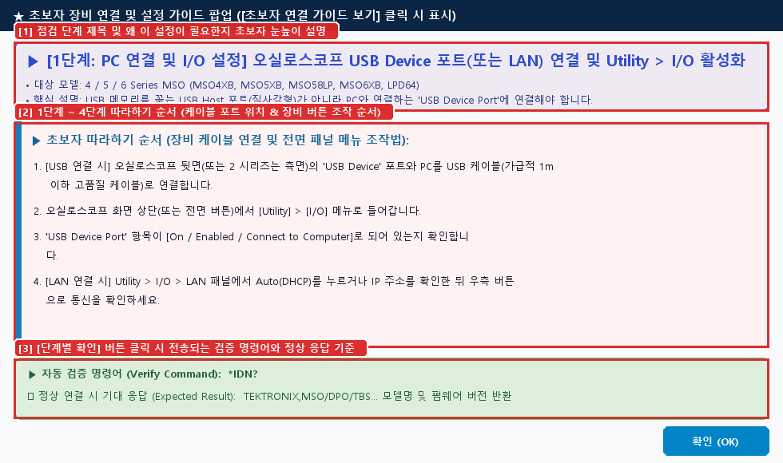

   - 메인 화면 좌측의 사전 준비 점검표에서도 각 항목의 **`[📘 초보자 연결 가이드 보기]`** 버튼을 클릭하면 위와 같이 **대상 모델, 핵심 설명, 1~4단계 따라하기 순서, 자동 검증 명령어 및 기대 결과**가 정리된 가이드 팝업창을 언제든 다시 확인할 수 있습니다.
5. **`[4] [🚀 선택한 장비 화면으로 이동하여 측정 시작하기]` 클릭**: 점검이 완료되면 우측 하단 파란색 시작 버튼을 클릭하여 선택한 장비 전용 탭이 열린 상태로 메인 프로그램을 시작합니다.

---

## 4. STEP 2. 메인 화면 전체 구조 한눈에 보기 (6대 영역)

메인 화면은 어떤 장비 탭을 선택하든 항상 동일한 **6대 핵심 영역(`①`~`⑥`)**으로 구성되어 있어 한 번만 익히면 모든 장비를 다룰 수 있습니다.

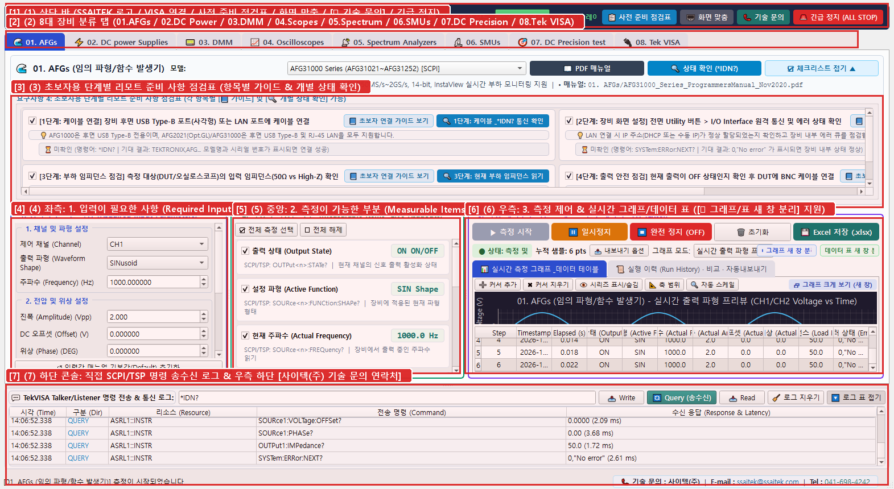

- **`① 상단 VISA 리소스 연결 바 (SSAITEK 로고 포함)`**: 좌측 상단 `SSAITEK` 로고, 장비 리소스 검색, 연결/해제, `[시뮬레이션 모드]` 전환, `[📋 사전 준비 점검표]` 재호출, `[🖥️ 화면 맞춤]`, `[📞 기술 문의]`, `[🚨 긴급 정지 (ALL STOP)]`
- **`② 8대 장비 분류별 탭`**: `01. AFGs` → `02. DC power Supplies` → `03. DMM` → `04. Oscilloscopes` → `05. Spectrum Analyzers` → `06. SMUs` → `07. DC Precision test` → `08. Tek VISA` 전용 작업 공간 전환
- **`③ 좌측 패널 (장비 모델 & 사전 준비 점검표 & 사용자 입력 필수 파라미터)`**: 세부 모델 선택, `[📖 PDF 매뉴얼]`, `[🔍 상태 확인 (*IDN?)]`, 단계별 점검 카드, 장비에 인가할 입력 파라미터 설정
- **`④ 중앙 패널 (측정 가능 항목 선택 & 실시간 수치 카드)`**: 수집할 측정 항목 체크박스 및 실시간 측정값 표시
- **`⑤ 우측 패널 (실시간 그래프 & 측정 데이터 테이블 & 새 창 분리)`**: `▶ 측정 시작` / `⏸ 일시정지` / `⏹ 완전 정지` / `💾 Excel 저장` 제어, `pyqtgraph` 실시간 파형/트렌드 그래프, 시계열 데이터 표 및 **`[🗗 그래프 새 창 분리]` / `[🗗 데이터 표 새 창 분리]`**
- **`⑥ 하단 패널 (직접 SCPI/TSP 명령어 송수신 & 실시간 I/O 로그 콘솔 & 기술 문의)`**: 모든 통신 명령과 응답 시간(ms)을 실시간 기록하며, 우측 하단 상태바에 **`📞 기술 문의 : 사이텍(주) | E-mail : ssaitek@ssaitek.com | Tel : 041-698-4242`** 연락처가 상시 표시됩니다.

---

## 5. STEP 3. 장비 연결하기 (`[VIRTUAL]` 가상 연습 모드 vs 실제 장비 USB/LAN 연결)

1. **장비 없이 연습할 때 (`[VIRTUAL]` 가상 시뮬레이션 모드)**:
   - 상단 연결 바의 **`[가상 시뮬레이션 (장비 없이 테스트)]`** 체크박스가 켜져 있으면 실제 계측기 없이도 내장된 물리 시뮬레이터가 실제 장비와 동일한 파형과 측정 데이터를 생성합니다.
2. **실제 계측기를 연결할 때 (USB / LAN)**:
   - 장비와 PC를 USB 케이블(Type-B / USB 3.0) 또는 LAN 케이블로 연결하고 전원을 켭니다.
   - 상단 **`[🔄 리소스 검색]`**을 클릭한 후 드롭다운에서 장비 주소(예: `USB0::0x0699::...::INSTR` 또는 `TCPIP0::192.168.1.100::inst0::INSTR`)를 선택합니다.
   - `[가상 시뮬레이션]` 체크를 해제하고 **`[🔌 연결]`** → **`[🆔 *IDN? 확인]`**을 클릭하여 장비 모델명과 시리얼 번호가 응답되는지 확인합니다.

---

## 6. STEP 4. 좌측 패널 — 장비 모델 선택, 매뉴얼 열기, [사용자 입력 필수 파라미터] 설정

1. **세부 장비 모델 선택**: 좌측 상단에서 본인이 사용하는 장비 모델을 선택합니다.
2. **사전 준비 점검표 확인**: 점검이 끝난 뒤에는 **`[🔼 점검표 접기]`** 버튼을 눌러 접어두면 아래 입력 파라미터 영역을 훨씬 넓게 사용할 수 있습니다.
3. **[사용자 입력 필수 파라미터] 설정**:
   - 주파수(Hz), 진폭(Vpp), 목표 전압(V), 제한 전류(A), 수직 스케일(V/div), 중심 주파수(MHz), 스윕 범위(Start/Stop V) 등 장비가 동작하기 위해 반드시 필요한 입력값을 설정합니다.

---

## 7. STEP 5. 중앙 패널 — [측정 가능 항목] 선택 및 동작 전 최종 확인 팝업

중앙 패널에서 측정할 항목들을 체크한 뒤 초록색 **`[▶ 측정 및 동작 시작 (Start)]`** 버튼을 누르면, 장비에 곧바로 출력을 내보내기 전에 아래와 같은 **안전 확인 팝업**이 먼저 나타납니다.

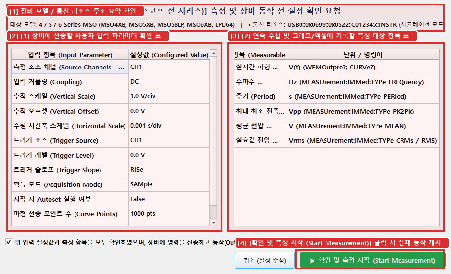

- **`[1] 장비 및 점검 상태 요약`**: 연결된 모델명, VISA 주소, 사전 준비 점검표 완료 여부를 보여줍니다.
- **`[2] 사용자 입력 필수 파라미터 요약 표`**: 장비에 전송될 전압/전류/주파수 설정값이 안전한지 최종 확인합니다.
- **`[3] 수집할 측정 항목 요약 표`**: 실시간 그래프와 엑셀에 기록될 측정 항목을 확인합니다.
- **`[4] [🚀 확인 완료 - 측정 및 동작 시작]` 클릭**: 확인 후 이 버튼을 눌러야 실제 장비 설정 및 측정이 시작됩니다.

---

## 8. STEP 6. 실시간 측정 제어 (`▶ 시작` / `⏸ 일시정지` / `⏹ 완전 정지`) 및 그래프 분석

- **`▶ 측정 및 동작 시작 (Start)`**: 설정값을 장비에 전송하고 지정한 주기(Poll Interval)마다 데이터를 연속 수집하여 우측 그래프와 표를 실시간 갱신합니다.
- **`⏸ 일시정지 (Pause)` / `▶ 측정 재개 (Resume)`**: 측정 루프를 잠시 멈춰 그래프를 자세히 관찰하고, 다시 누르면 이어서 측정합니다.
- **`⏹ 완전 정지 (Complete Stop & Safe Output OFF)`**: 측정을 완전히 종료하며, 신호발생기(AFG)·전원공급기(DC Power/MP5000)·소스미터(SMU)의 **전원/신호 출력을 즉시 안전하게 OFF(`OUTP OFF`)로 차단**합니다.

---

## 9. 8개 장비 분류별 측정 실습 및 고급 화면 기능 가이드 (`01. AFGs` ~ `08. Tek VISA`)

### ① `01. AFGs` · `02. DC power Supplies` · `03. DMM`
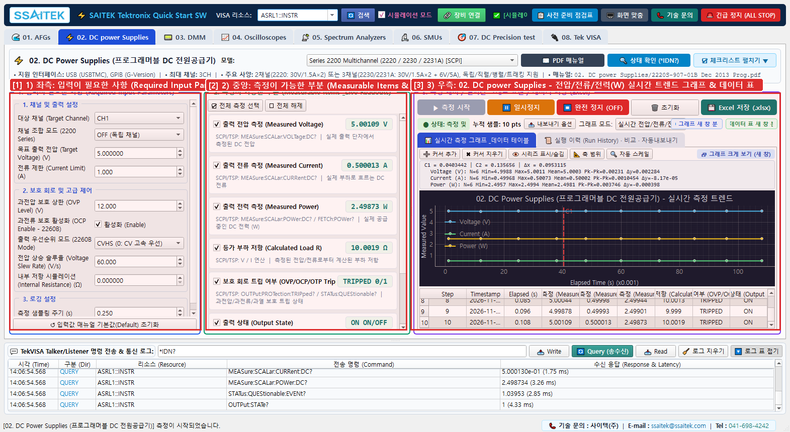
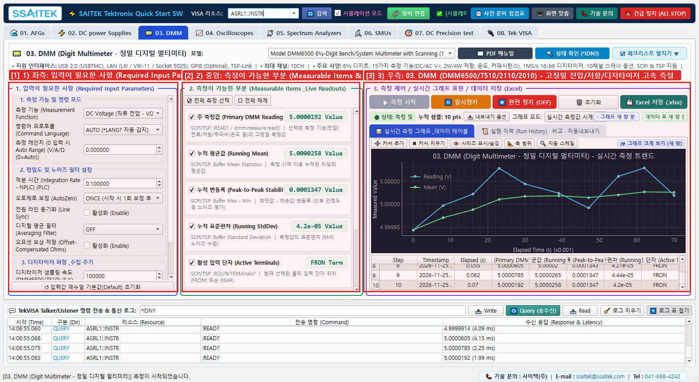
- **`01. AFGs`**: 파형(SIN/SQU/RAMP/PULS), 주파수(Hz), 진폭(Vpp), 오프셋(V)을 입력하고 출력 파형 프리뷰와 설정 상태를 확인합니다.
- **`02. DC power Supplies` (Series 2200 / 2260B)**: 목표 전압(V)과 전류 제한(A)을 설정하고 시간에 따른 실제 출력 전압(V)·전류(A)·전력(W) 트렌드 그래프를 모니터링합니다(측정 중 전압/전류 변경 실시간 반영 및 USB-CDC 세션 자동 유지 지원).
- **`03. DMM` (Keithley DMM6500 / DMM7510 / Model 2110 / Model 2010)**: 5½ ~ 7½ 디지트 정밀 멀티미터로 DC/AC 전압·전류, 2선/4선 저항, 주파수, 온도, 커패시턴스 및 1 MS/s 디지타이저 파형과 누적 평균/변동폭(Pk-Pk)/표준편차/단자 위치(`FRON`/`REAR`)를 초당 16~20회 이상 고속 측정합니다.

### ② `04. Oscilloscopes` (다중 채널 `CH1~CH4` 동시 파형 캡처 및 자동 계측)
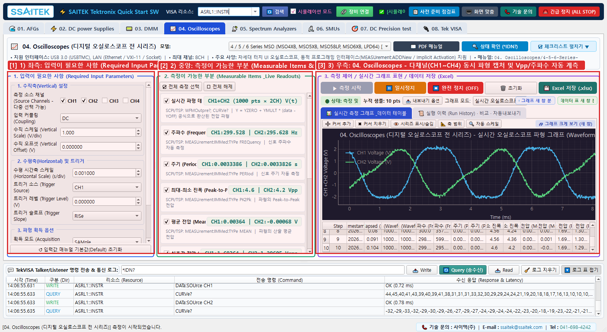
- **다중 채널(`☑ CH1 ☑ CH2 ☑ CH3 ☑ CH4`) 동시 선택**: 원하는 채널들을 여러 개 동시에 체크하면 모든 선택 채널의 파형(`CURVe?`)이 한 그래프에 색상별로 동시에 겹쳐서(Overlay) 표시되고, 표와 Excel에는 `[CH1]`, `[CH2]` 등 채널별 컬럼과 파형 데이터가 분리 저장됩니다.
- **실시간 파형 + 주파수/주기/진폭 동시 고속 측정**: 파형과 수치 항목(주파수, 주기, Vpp, Mean, RMS)을 함께 체크해도 지연이나 타임아웃 없이 설정 주기(예: `0.500s`)에 맞춰 정확히 수집되며, `시작 시 Autoset 실행 여부` 체크 시에도 오토셋 완료(`*OPC?`)를 자동 대기한 뒤 측정을 시작합니다.

### ③ `05. Spectrum Analyzers` (RF 스펙트럼 트레이스 및 피크 탐색)
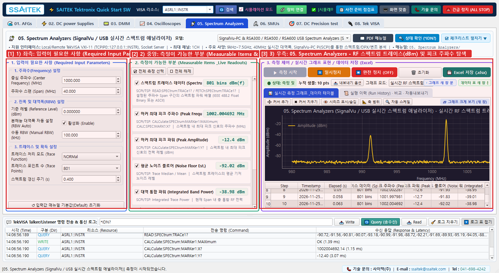
- 중심 주파수(Center Freq MHz), 스팬(Span MHz), 기준 레벨(Ref Level dBm)을 입력하고 주파수 영역 RF 스펙트럼 트레이스(dBm vs MHz) 및 최대 피크 파워/주파수를 실시간 추적합니다.

### ④ `06. SMUs` · `07. DC Precision test` (MP5000) · `08. Tek VISA`
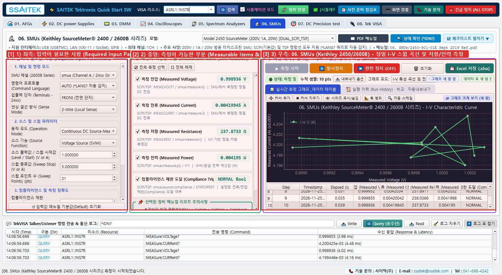
- **`06. SMUs`**: 전압/전류 소스 및 스윕 범위(Start ~ Stop), 컴플라이언스 한계(Compliance Limit)를 설정하여 반도체/저항 소자의 실시간 I-V 특성 곡선과 저항(`Ω`), 전력(`W`)을 측정합니다.
- **`07. DC Precision test` (MP5000)**: MP5103 메인프레임의 슬롯(Slot 1~3)과 모듈(SMU / PSU)을 선택하여 TSP(`slot[Z].smu[X].*`) 명령어로 정밀 소스·측정 및 스윕을 수행합니다.
- **`08. Tek VISA`**: 원하는 SCPI/TSP 명령어를 반복 쿼리하면서 수치 응답과 통신 지연 시간(Latency ms)을 정밀 진단합니다.

### ⑤ 실행 이력(Run History) 비교 및 그래프 커서 통계
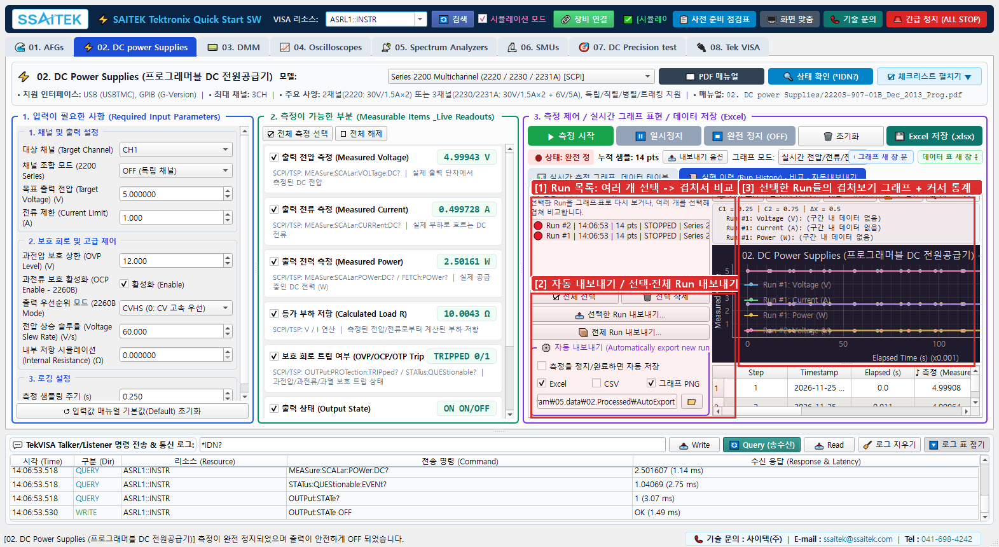
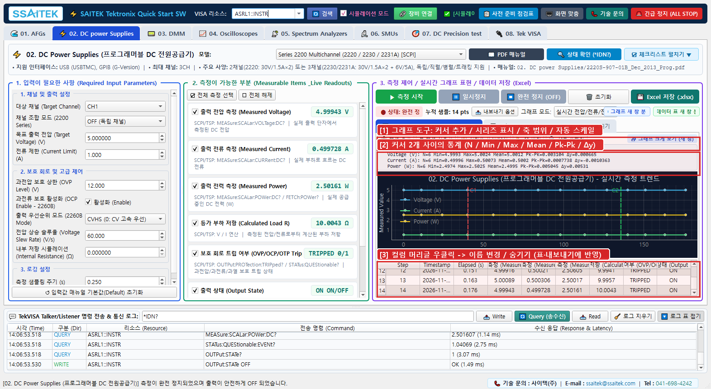
- **`📜 실행 이력 (Run History)`**: 측정을 새로 시작해도 이전 측정이 사라지지 않고 `Run #1, #2...`로 자동 보존되며, 여러 Run을 선택해 한 그래프에 겹쳐 비교하거나 자동 내보내기(Excel/CSV/PNG)를 설정할 수 있습니다.
- **`➕ 커서 추가` & `👁 시리즈 표시/숨김` & 컬럼 편집**: 그래프에 커서 2개를 놓아 구간 통계(`N / Min / Max / Mean / Pk-Pk / Δy`)를 확인하고, 표 머리글을 우클릭해 컬럼 이름을 변경하거나 숨길 수 있습니다.

### ⑥ 그래프 및 측정 데이터 테이블 개별 새 창 분리 (`Pop-Out`) & 기술 문의
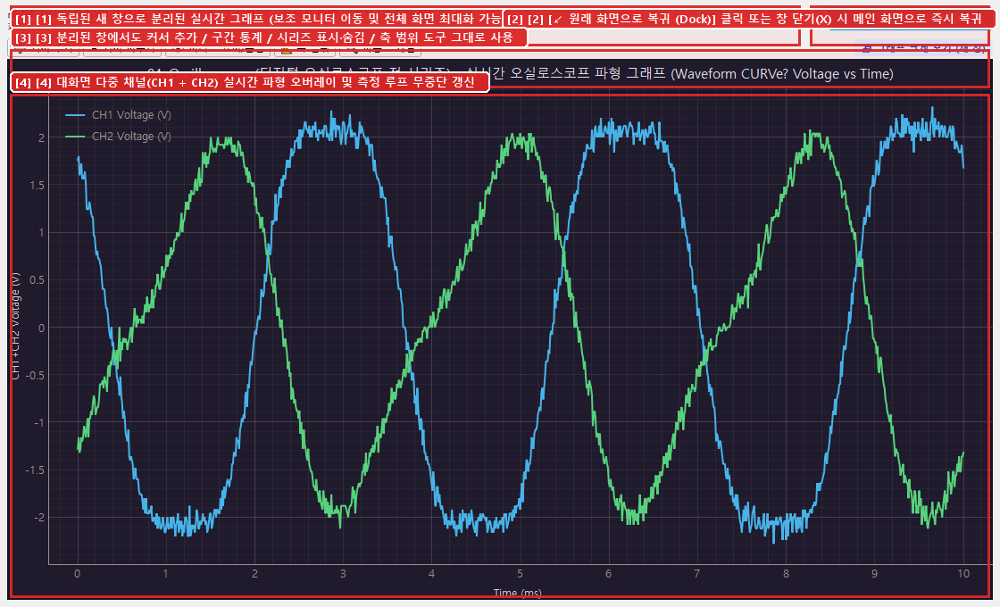
- **`[🗗 그래프 새 창 분리]` & `[🗗 데이터 표 새 창 분리]`**: 우측 측정 패널 상단의 버튼을 누르면 실시간 그래프나 측정 데이터 표를 각각 독립된 윈도우 창으로 분리하여 보조 모니터로 옮기거나 전체 화면으로 크게 볼 수 있습니다. 분리된 창 우측 상단의 **`[↙ 원래 화면으로 복귀 (Dock)]`** 버튼을 누르거나 창을 닫으면 즉시 원래 자리로 돌아옵니다.
- **기술 문의 (사이텍(주))**:
  - **회사명**: 사이텍(주) (SSAITEK)
  - **E-mail**: `ssaitek@ssaitek.com`
  - **Tel**: `041-698-4242`

---

## 10. STEP 7. 측정 데이터 Excel (`.xlsx`) 4-시트 자동 저장 및 초보자 FAQ

중앙 패널의 파란색 **`[📊 측정 데이터 Excel (.xlsx) 저장]`** 버튼을 클릭하면 아래 **4개 시트**가 완비된 엑셀 리포트 파일이 자동 생성됩니다.

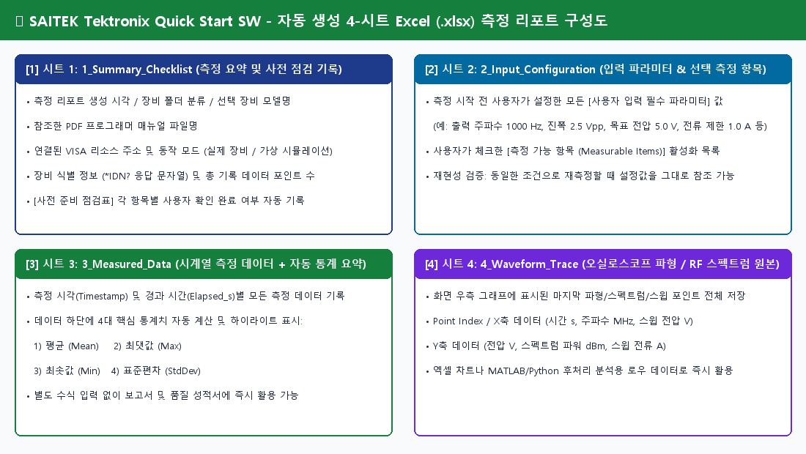

1. **`1_Summary_Checklist`**: 측정 일시, 장비 분류, 모델명, 참조 매뉴얼 파일, VISA 주소, `*IDN?` 응답 및 사전 준비 점검표 체크 이력
2. **`2_Input_Configuration`**: 측정 시작 시 입력한 모든 필수 파라미터 값 및 선택된 측정 항목 목록
3. **`3_Measured_Data`**: 시계열 측정 데이터 전체 + 하단 **평균(Mean) / 최댓값(Max) / 최솟값(Min) / 표준편차(StdDev)** 자동 계산 행
4. **`4_Waveform_Trace`**: 마지막에 캡처된 오실로스코프 파형 / RF 스펙트럼 / I-V 스윕 포인트 원본 데이터 전체
